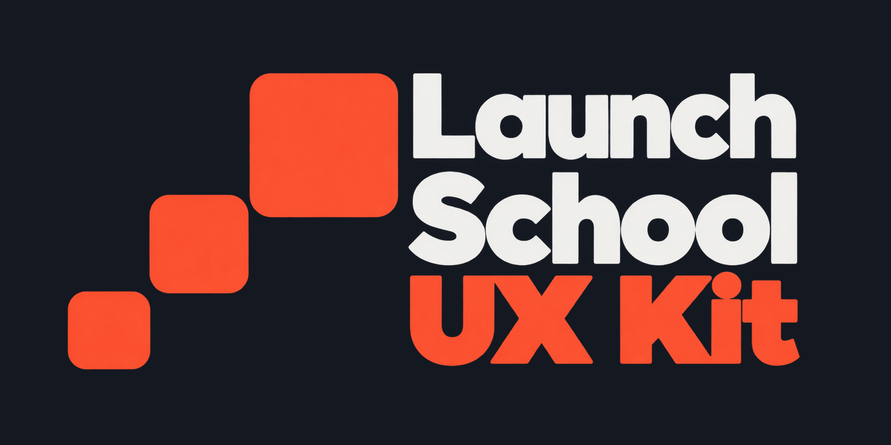

# Launch School UX Kit branding

- Current aligned logo: [Dark-background PNG](launch-school-ux-kit-aligned-dark.png) · [Light-background PNG](launch-school-ux-kit-aligned.png) · [Dark-background SVG](launch-school-ux-kit-aligned-dark.svg) · [Light-background SVG](launch-school-ux-kit-aligned.svg)
- [Light preview](preview-light.png): background `#F6F6F6`, Launch and School lettering in `#636363`, and squares and UX Kit lettering in `#F75C5F` with clean edges.
- Previous image_gen refinement: [Dark-background PNG](launch-school-ux-kit-refined-dark.png) · [Light-background PNG](launch-school-ux-kit-refined.png) · [Dark preview](preview-refined.png)
- [Selected image_gen foundation](imagegen-foundation.png)
- [Refinement prompt](refinement-prompt.txt)
- [Alignment prompts](alignment-prompt.txt)
- [Dark-version prompt](dark-version-prompt.txt)
- [Exact layout measurements](aligned-layout.json)
- [Rebuild script](build-aligned-logo.py)

PNG previews show the dark version on charcoal (`#141821`) by default. The dark logo assets have transparent backgrounds and off-white (`#F2F2F0`) Launch and School lettering, with the coral accent preserved.

The current aligned logo uses direct editing to retain the foundation's original text pixels. No text was regenerated, resized, or respaced horizontally. School moves down 9 pixels and UX Kit moves down 30 pixels, creating two equal 32-pixel gaps between the visible rows. The light PNG's text crops match the foundation pixel for pixel; the dark PNG changes only the first two rows' RGB color and preserves their alpha masks exactly.

The blocks are true squares with a 35% increase in side length at each step. At each transition, the vertical overlap is 20% of the smaller square's height; overlap distances and both horizontal and vertical position increments therefore grow with the same size ratio. Corner radii are 9% of each side. The largest block's top and smallest block's bottom match the text column at y=32 and y=590 in the cropped PNGs. Block color is coral (`#FD533A`).

Aligned PNGs, SVGs, and the default preview share a 1504 × 622 presentation with equal 32-pixel margins around the visible logo on all four sides. Cropping uses integer pixel coordinates, preserving the lettering without resizing or resampling; SVGs use the matching viewBox. Visible bounds are measured at 50% alpha, excluding faint transparent-edge noise from the foundation.

The current aligned SVGs combine vector squares with embedded raster lettering from the foundation. The wordmark is not outlined vector text; retaining the original pixels preserves its exact appearance. Rebuild the aligned PNGs, SVGs, default preview, and measurements with `python3 docs/branding/build-aligned-logo.py` (requires ImageMagick and `rsvg-convert`). The script checks pixel preservation and dark alpha masks during generation.

The earlier vector reconstruction is retained for comparison:

- [Light-background SVG](launch-school-ux-kit.svg) · [Transparent PNG](launch-school-ux-kit.png)
- [Dark-background SVG](launch-school-ux-kit-dark.svg) · [Transparent PNG](launch-school-ux-kit-dark.png)
- [Standalone SVG mark](launch-school-ux-kit-mark.svg)
- [Dark preview](preview-vector-dark.png)

Those SVGs use outlined Avenir Next Heavy lettering and flat coral (`#FF543A`) and charcoal (`#292928`) colors, with off-white (`#F2F2F0`) lettering in the dark-background variant. Their block side lengths increase by 35%, with 3% corner radii and non-overlapping height ranges.
