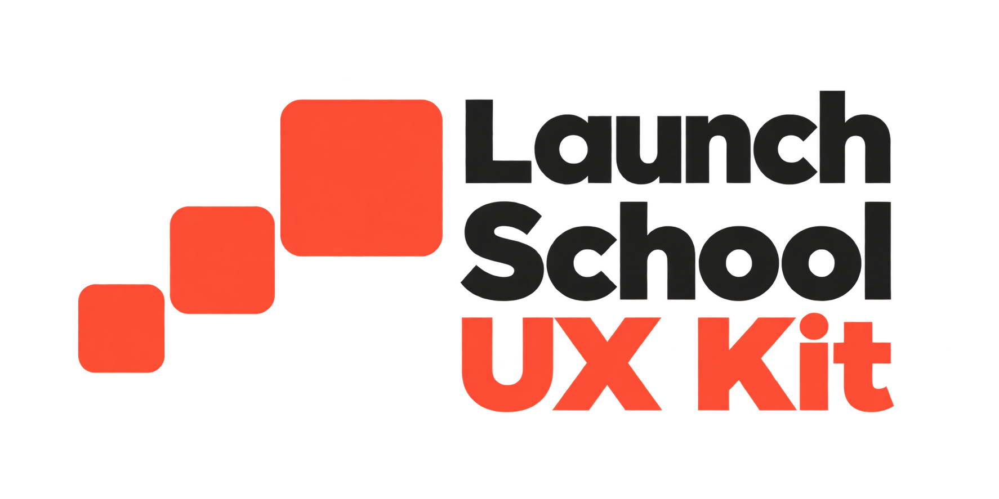

# Launch School UX Kit branding

- [Current image_gen refinement](launch-school-ux-kit-refined.png)
- [Selected image_gen foundation](imagegen-foundation.png)
- [Refinement prompt](refinement-prompt.txt)

The current logo refines the selected foundational image directly with the built-in image_gen tool, preserving its font style and charcoal and coral palette. The refinement requests moderately rounded squares, overlapping vertical ranges, and balanced text-row whitespace between the tight foundation and the more spacious vector version. Its transparent PNG is a generated design; exact square ratios and alignments in the prompt are design targets rather than measured vector constraints.

The earlier vector reconstruction is retained for comparison:

- [Light-background SVG](launch-school-ux-kit.svg) · [Transparent PNG](launch-school-ux-kit.png)
- [Dark-background SVG](launch-school-ux-kit-dark.svg) · [Transparent PNG](launch-school-ux-kit-dark.png)
- [Standalone SVG mark](launch-school-ux-kit-mark.svg)
- [Light and dark preview](preview.png)

Those SVGs use outlined Avenir Next Heavy lettering and flat coral (`#FF543A`) and charcoal (`#292928`) colors, with off-white (`#F2F2F0`) lettering in the dark-background variant. Their block side lengths increase by 35%, with 3% corner radii and non-overlapping height ranges.
