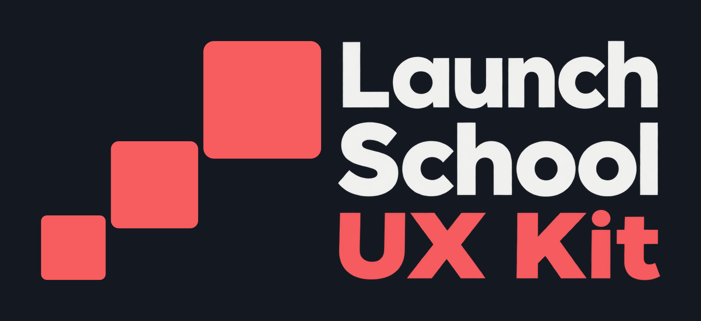

# Launch School UX Kit branding

- Light logo: [Transparent PNG](logo/launch-school-ux-kit-logo.png) · [SVG](logo/launch-school-ux-kit-logo.svg)
- Dark logo: [Transparent PNG](logo/launch-school-ux-kit-logo-dark.png) · [SVG](logo/launch-school-ux-kit-logo-dark.svg)
- [Light preview](logo/preview-light.png): background `#F6F6F6`, Launch and School lettering in `#636363`, and squares and UX Kit lettering in `#F75C5F` with clean edges.

PNG previews show the dark version on charcoal (`#141821`) by default. Both logo variants have transparent backgrounds. The light logo uses gray (`#636363`) Launch and School lettering; the dark logo uses off-white (`#F2F2F0`). Squares and UX Kit lettering use coral (`#F75C5F`) in both variants, with clean edges and no gray outline.

Recoloring changes RGB values without regenerating or resizing any lettering. The visible text rows have equal 32-pixel gaps.

The blocks are true squares with a 35% increase in side length at each step. Both horizontal edge-to-edge gaps are 12.At each transition, the vertical overlap is 20% of the smaller square's height. Corner radii are 9% of each side. The largest block's top and smallest block's bottom match the text column at y=96 and y=654 in the PNGs.

PNGs, SVGs, and both previews share a 1635 × 750 presentation with equal 96-pixel margins around the visible logo on all four sides. SVGs use the matching viewBox, with the lettering's size and internal spacing preserved. Visible bounds are measured at 50% alpha.

SVGs combine vector squares with embedded raster lettering. The wordmark is not outlined vector text; its original alpha masks preserve the foundational letter shapes. SVG color filters recolor the lettering without changing its opacity.
